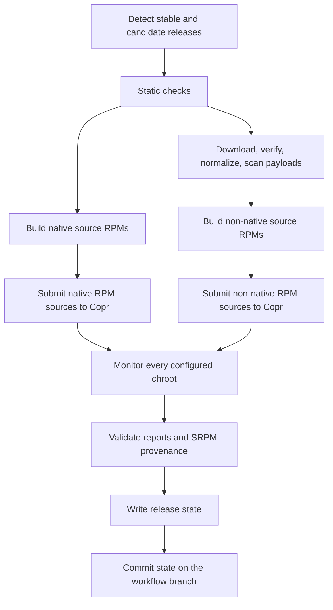

# Build and publication architecture

The single `build-rpm.yml` workflow is the entry point for scheduled, manual,
and `repository_dispatch` runs. Its shared concurrency group serializes runs.

The four package identities are independent:

| Channel | Family | RPM name | Executable |
| --- | --- | --- | --- |
| Stable | Native | `freecad` | `freecad` |
| Candidate | Native | `freecad-candidate` | `freecad-can` |
| Stable | Non-native | `freecad-non-native` | `freecad-non-native` |
| Candidate | Non-native | `freecad-candidate-non-native` | `freecad-can-non-native` |

The release detector reconciles each independent counter in
`state/<package>.json` against Copr's package-specific build history. Only a
successful record covering every configured chroot advances the published
counter; failed, canceled, and partial builds are ignored. A packaging change
increments after the highest successful RPM release for that upstream version.
If state claims a release Copr cannot verify, detection stops for investigation.
State is written only after every requested Copr chroot succeeds and the
corresponding scan and SRPM provenance reports validate.

The configured Copr chroots are listed in [`../chroots.txt`](../chroots.txt).
They cover Fedora 44, Fedora 45, Fedora Rawhide, openEuler 24.03, openSUSE Leap
16.0, and openSUSE Tumbleweed, each on x86_64 and aarch64.

# Operational requirements

- Configure the `COPR_CONFIG` Actions secret with a Copr API client config.
- `VT_API_KEY` is optional; VirusTotal lookups are hash-only and advisory when
  unavailable or rate-limited.
- The workflow token needs permission to write the successful state commit to
  the branch that triggered the run.
- A failed or skipped package job prevents state finalization.

# Validation boundary

Local tests and spec expansion do not prove that Copr can resolve every
`BuildRequires` or complete the full FreeCAD build in all twelve targets. That
requires successful target builds; see [native dependencies](native-dependencies.md).

The reviewed non-native-only historical files and their migration decisions
are recorded in the [archive audit](archive-audit.md). Mixed native/non-native
archive files were excluded from that review.
